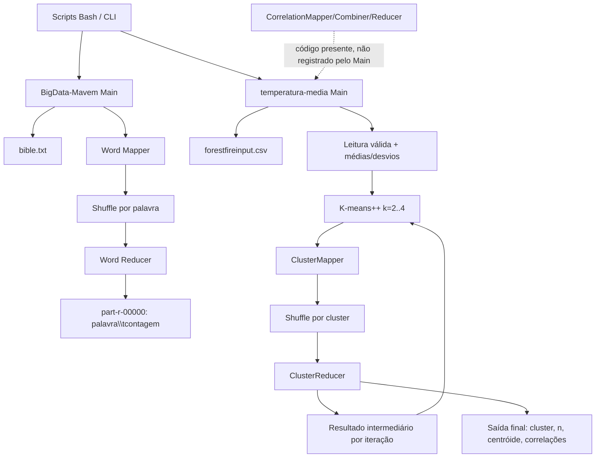

# Diagrama de arquitetura e fluxo

## Fluxos principais

1. O job de palavras força execução local e grava a agregação textual.
2. O job de incêndios lê os registros válidos antes do MapReduce para calcular
   normalização; em seguida executa jobs intermediários até convergência ou 50
   iterações para cada `k` de 2 a 4.
3. O reducer de clustering calcula simultaneamente centróides normalizados e
   correlações temperatura-versus-variável por cluster.
4. O filesystem é a única fronteira de dados entre processo e job. Não há
   estado compartilhado entre os dois projetos.
